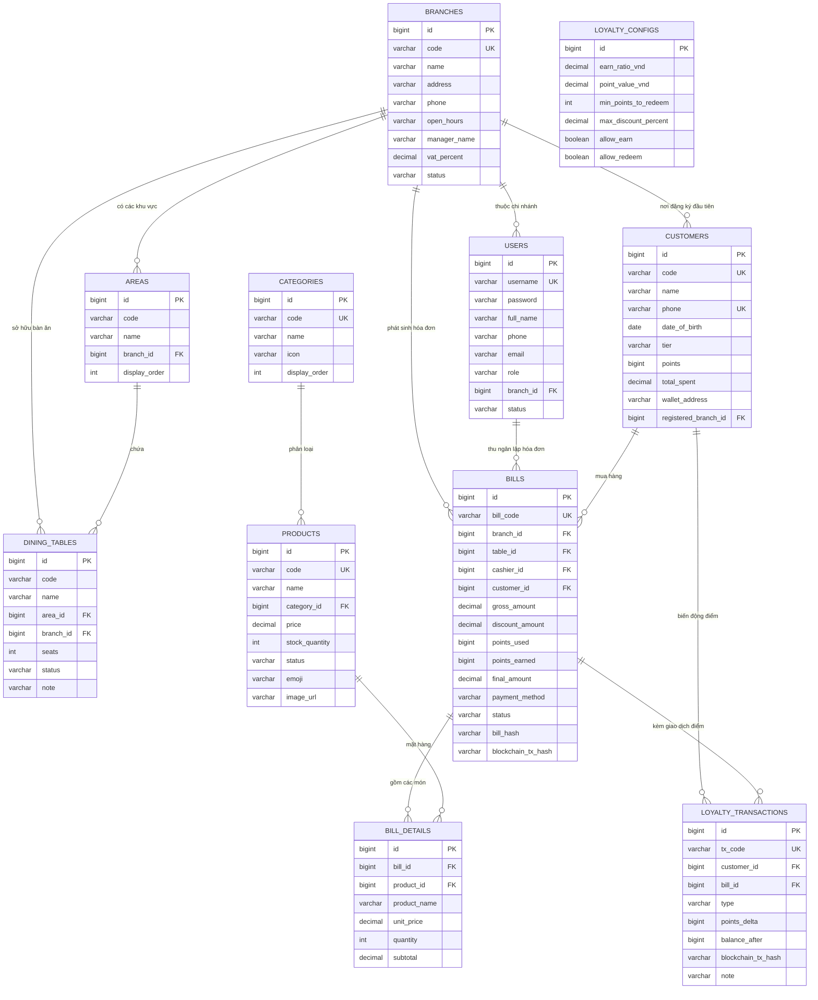

# 📌 TÀI LIỆU TOÀN DIỆN: KIẾN TRÚC HỆ THỐNG CHAINPOINT & KẾ HOẠCH CHUYỂN ĐỔI LOCALSTORAGE SANG DATABASE

> **Dự án**: ChainPoint — Hệ thống Quản lý Bán hàng Nhà hàng Đa chi nhánh (POS Multi-Branch) kết hợp Tích điểm Khách hàng Thân thiết Bất biến trên Blockchain (Loyalty Web3 Token).  
> **Phiên bản tài liệu**: 1.0  
> **Ngày cập nhật**: 14/11/2026  
> **Mục tiêu chính**: Phân tích toàn bộ hiện trạng dự án, chỉ rõ các điểm nghẽn của việc lưu dữ liệu tạm thời trên `localStorage`, lập kế hoạch chi tiết thiết kế Cơ sở Dữ liệu (Database Schema / ERD), chỉ ra chính xác các tệp mã nguồn cần sửa đổi ở Backend và Frontend để các lượt phát triển tiếp theo có thể dễ dàng hiện thực hóa.

---

## 1. TỔNG QUAN HỆ THỐNG CHAINPOINT

ChainPoint là giải pháp quản lý bán hàng (POS) dành riêng cho mô hình chuỗi nhà hàng (F&B Multi-Branch), giải quyết bài toán chống gian lận doanh thu và minh bạch hóa điểm thưởng khách hàng bằng công nghệ Blockchain.

### 1.1. Các mô hình cốt lõi
1. **Kiến trúc Đa chi nhánh (Multi-Branch)**:
   - Hệ thống gồm nhiều cơ sở (ví dụ: Chi nhánh Quận 1, Chi nhánh Thảo Điền, Chi nhánh Hoàn Kiếm,...).
   - Mỗi chi nhánh có tài khoản Quản lý (`ROLE_MANAGER`) và các Thu ngân (`ROLE_CASHIER`) riêng biệt. Dữ liệu bàn ăn, đơn hàng thời gian thực, doanh thu hàng ngày được phân quyền theo chi nhánh (`branch_id`).
   - Chủ chuỗi nhà hàng (`ROLE_OWNER`) có quyền hạn tối cao: tạo chi nhánh, bổ nhiệm quản lý, theo dõi biểu đồ doanh thu toàn chuỗi và so sánh hiệu quả kinh doanh giữa các cơ sở.
2. **Mô hình Tích điểm & Đổi điểm (Lấy cảm hứng từ Bách Hóa Xanh)**:
   - **Tỷ lệ tích điểm**: Mỗi `100.000 ₫` chi tiêu = `1 điểm` tích lũy.
   - **Tỷ lệ đổi điểm**: `1 điểm` = `1.000 ₫` trừ trực tiếp vào hóa đơn thanh toán.
   - **Quy tắc bảo vệ**: Đổi tối thiểu `5 điểm` (`5.000 ₫`), giảm tối đa `50%` tổng giá trị hóa đơn.
3. **Bảo mật & Bất biến trên Blockchain (Web3 Loyalty & Anti-Fraud)**:
   - Smart Contract `RestaurantLoyalty.sol` (Solidity 0.8.20) lưu số dư điểm theo địa chỉ ví hoặc hash số điện thoại khách hàng.
   - Mỗi hóa đơn sau khi thanh toán được băm bằng SHA-256 (`bill_hash`) và ghi vết giao dịch lên Blockchain Sepolia (`blockchain_tx_hash`), ngăn chặn việc nhân viên xóa đơn hoặc sửa số tiền sau ca làm việc.

---

## 2. HIỆN TRẠNG LƯU TRỮ TRÊN FRONTEND (LOCALSTORAGE) & RỦI RO

Hiện tại, toàn bộ giao diện Frontend đang vận hành độc lập bằng các dữ liệu Mock lưu trong `localStorage` và `sessionStorage` của trình duyệt. 

### 2.1. Bảng thống kê các khóa (Keys) đang lưu trên Trình duyệt

| Tên Khóa (Key) | Nơi Sử Dụng | Nội Dung / Cấu Trúc Dữ Liệu |
| :--- | :--- | :--- |
| `cp_role` | `login.js`, `branch-nav.js` | Vai trò đang đăng nhập: `owner`, `manager`, `cashier`. |
| `cp_user` | `login.js`, `common.js` | Tên đăng nhập: `owner`, `manager_q1`, `cashier_q1`... |
| `cp_branch` | `login.js`, `branches.js` | Tên chi nhánh hiện tại đang làm việc hoặc quản trị. |
| `cp_branches_data` | `admin/branches.js` | Danh sách 3 chi nhánh mẫu (mã, tên, địa chỉ, quản lý, hotline, số bàn, số NV, doanh thu tuần). |
| `cp_staff_list` | `admin/staff.js`, `branch/staff.js` | Danh sách 7 nhân viên mẫu gồm Quản lý và Thu ngân gắn với từng chi nhánh. |
| `cp_areas` | `admin/tables.js`, `pos/data.js` | Danh sách khu vực bàn ăn: `f1` (Tầng 1), `f2` (Tầng 2), `garden` (Sân vườn). |
| `cp_configured_tables` | `admin/tables.js`, `pos/data.js` | Danh sách 22 bàn ăn (mã bàn A1..A8, B1..B8, C1..C6, khu vực, số ghế, trạng thái, ghi chú). |
| `cp_branch_menu` | `branch/menu.js`, `pos/data.js` | Danh mục và 24 món ăn thực đơn kèm giá, biểu tượng emoji, số lượng đã bán, trạng thái tồn kho. |
| `pos.orders` | `pos/store.js`, `pos/order.js` | Danh sách các bàn đang có khách ngồi và các món đã gọi (chưa thanh toán). |
| `pos.pending` | `pos/store.js`, `pos/pending.js` | Các hóa đơn đã in phiếu tạm tính, đang đợi thanh toán (tiền mặt / chuyển khoản). |
| `pos.history` | `pos/store.js`, `branch/orders.js`, `revenue.js` | Danh sách tất cả hóa đơn đã thanh toán thành công (dùng để vẽ biểu đồ doanh thu). |
| `pos.mockPaid` | `pos/store.js`, `payment-transfer.js` | Cờ giả lập xác nhận chuyển khoản ngân hàng thành công qua QR VietQR. |
| `cp_customers` | `common/loyalty-store.js`, `customers.js` | Danh sách 5 khách hàng hội viên (Tên, SĐT, ngày sinh, hạng thẻ Bạc/Vàng/KC, điểm tích lũy). |
| `cp_loyalty_config` | `common/loyalty-store.js`, `loyalty.js` | Tỷ lệ tích điểm (10.000đ = 1đ), tỷ lệ đổi (1đ = 1.000đ), mức tối thiểu đổi điểm. |
| `cp_point_transactions` | `common/loyalty-store.js`, `loyalty.js` | Lịch sử các giao dịch cộng điểm (earn), trừ điểm (redeem) của khách. |
| `cp_branch_settings_<ChiNhánh>` | `branch/settings.js` | Cấu hình vận hành riêng từng cơ sở: VAT (8%), giờ mở/đóng cửa, hotline, máy in tự động. |

### 2.2. Các hạn chế nguy hiểm khi lưu trên LocalStorage
1. **Không đồng bộ giữa các máy (Data Isolation)**: Thu ngân tạo đơn hoặc tính tiền trên máy POS, nhưng máy tính của Quản lý chi nhánh hoặc Chủ chuỗi không xem được do dữ liệu chỉ nằm trong bộ nhớ máy POS đó.
2. **Nguy cơ gian lận và can thiệp mã (Zero Security)**: Bất kỳ ai mở DevTools (F12) đều có thể chỉnh sửa `localStorage.setItem('cp_customers', ...)` để tự cộng hàng ngàn điểm thưởng hoặc đổi giá tiền món ăn.
3. **Mất toàn bộ dữ liệu**: Khi xóa lịch sử duyệt web hoặc đổi máy tính, toàn bộ dữ liệu đơn hàng và doanh thu của nhà hàng sẽ biến mất hoàn toàn.
4. **Vi phạm chuẩn Multi-tenant / Multi-branch**: Không thể kiểm soát bảo mật dữ liệu giữa các cơ sở nếu không có phân quyền tập trung tại Database.

---

## 3. NƠI CẦN SỬA ĐỂ TẠO VÀ CHUYỂN DỮ LIỆU SANG DATABASE

Để hệ thống chuyển sang lưu trữ bền vững trên Database, cần can thiệp vào các thành phần sau:

### 3.1. Sửa tệp cấu hình Spring Boot (`application.yml`)
- **Đường dẫn**: `d:\ChainPoint\src\main\resources\application.yml`
- **Các điểm cần sửa**:
  1. **Tên Database**: URL hiện tại là `...:4000/sys?...`. Bảng `sys` là schema hệ thống của MySQL/TiDB. Cần đổi tên database thành `chainpoint_db` hoặc database thực tế được cấp phép.
  2. **Cơ chế DDL Hibernate**: Đổi `spring.jpa.hibernate.ddl-auto: none` thành:
     - `update`: Để Hibernate tự động so sánh các Entity Java và tạo bảng / thêm cột tự động khi ứng dụng khởi chạy.
     - Hoặc kết hợp script khởi tạo: `spring.sql.init.mode: always` để nạp dữ liệu mẫu ban đầu từ `schema.sql` và `data.sql`.

```yaml
# Ví dụ cấu hình chuẩn sau khi sửa:
spring:
  datasource:
    url: jdbc:mysql://gateway01.ap-southeast-1.prod.aws.tidbcloud.com:4000/chainpoint_db?sslMode=VERIFY_IDENTITY&useUnicode=true&characterEncoding=UTF-8&serverTimezone=UTC&connectTimeout=10000
    username: pf5fvqEKCvScA6d.root
    password: 3N5Q8en1yV8esiXO
    driver-class-name: com.mysql.cj.jdbc.Driver
  jpa:
    hibernate:
      ddl-auto: update # Tự động tạo và cập nhật bảng từ Entity
    show-sql: true
    properties:
      hibernate:
        format_sql: true
        dialect: org.hibernate.dialect.MySQLDialect
```

### 3.2. Sửa và Bổ sung các Entity Backend (`src/main/java/blockchain/ChainPoint/entity/`)
Hiện tại Backend đã có 7 Entity: `Branch`, `User`, `Customer`, `DiningTable`, `Product`, `Bill`, `BillDetail`. Để hỗ trợ toàn diện các tính năng của giao diện, cần chỉnh sửa và tạo mới các Entity sau:

1. **Entity mới: `Area.java` (Quản lý khu vực bàn theo chi nhánh)**:
   - Thay thế trường `area: String` tĩnh trong `DiningTable`.
   - Các thuộc tính: `id`, `name` (Tầng 1, Tầng 2, Sân vườn), `code` (`f1`, `f2`, `garden`), `branch` (ManyToOne `Branch`), `display_order`.
2. **Entity mới: `Category.java` (Quản lý danh mục món ăn)**:
   - Chuẩn hóa trường `category: String` trong `Product`.
   - Các thuộc tính: `id`, `code` (`hot`, `cold`, `drink`, `dessert`, `other`), `name` (Món nóng, Đồ uống...), `icon` (Emoji ✨, 🔥, 🥤), `display_order`.
3. **Entity mới: `LoyaltyConfig.java` (Cấu hình chương trình tích điểm)**:
   - Lưu trữ các chỉ số của Bách Hóa Xanh: `earn_ratio_vnd` (10.000đ), `point_value_vnd` (1.000đ), `min_points_to_redeem` (5), `max_discount_percent` (50%), `allow_earn`, `allow_redeem`.
4. **Entity mới: `LoyaltyTransaction.java` (Lịch sử giao dịch điểm)**:
   - Thay thế `cp_point_transactions`.
   - Các thuộc tính: `id`, `tx_code`, `customer` (ManyToOne), `bill` (ManyToOne, nullable), `type` (`EARN`, `REDEEM`, `REFUND`), `points_delta`, `balance_after`, `blockchain_tx_hash`, `note`, `created_at`.
5. **Cập nhật Entity `Branch.java`**:
   - Thêm các trường từ trang cài đặt chi nhánh (`settings.html`): `open_hours`, `hotline`, `manager_name`, `vat_percent` (mặc định 8%), `auto_print_bill`.
6. **Cập nhật Entity `Bill.java`**:
   - Thay thế các trường lưu text tự do thành quan hệ chuẩn: `diningTable` (ManyToOne `DiningTable`), `customer` (ManyToOne `Customer`, nullable), `cashier` (ManyToOne `User`).

### 3.3. Bổ sung Controller, Service và Repository ở Backend
Hiện tại Backend mới chỉ có `AuthController`, `DashboardController`, `DiningTableController`, `PosController`, `ProductController`. Cần tạo bổ sung:
- **`BranchController` & `BranchService`**: Cho phép Owner thêm, sửa, xóa, lấy danh sách chi nhánh (thay thế `admin/branches.js`).
- **`StaffController` & `UserService`**: Cho phép Owner hoặc Manager tạo tài khoản nhân viên theo cơ sở (thay thế `admin/staff.js` và `branch/staff.js`).
- **`CustomerController` & `CustomerService`**: Tra cứu khách hàng theo SĐT ngay tại POS, tạo mới khách hàng, hiển thị danh sách hội viên.
- **`LoyaltyController` & `LoyaltyService`**: Quản lý cấu hình tích điểm và xem lịch sử giao dịch điểm.
- **`OrderController` / `BillController`**: Cho phép xem danh sách đơn hàng đã bán theo chi nhánh, lọc theo ngày, xem chi tiết món ăn (thay thế `branch/orders.js`).

### 3.4. Sửa đổi Tầng Giao tiếp Frontend (Frontend JS)
Xóa bỏ các hàm `localStorage.getItem` / `localStorage.setItem` xử lý nghiệp vụ, chuyển thành gọi REST API qua `fetch()` hoặc `axios`:
- Tạo file dùng chung: `Frontend/js/common/api-client.js`:
  ```javascript
  const BASE_URL = 'http://localhost:8080/api/v1';

  async function apiFetch(endpoint, options = {}) {
      const token = sessionStorage.getItem('cp_token');
      const headers = {
          'Content-Type': 'application/json',
          ...(token ? { 'Authorization': `Bearer ${token}` } : {}),
          ...options.headers
      };
      const res = await fetch(`${BASE_URL}${endpoint}`, { ...options, headers });
      if (res.status === 401) {
          sessionStorage.clear();
          window.location.href = '/Frontend/pages/auth/login.html';
          return;
      }
      return res.json();
  }
  ```
- **Tại POS (`Frontend/pos/js/store.js`)**: Thay vì đọc/ghi vào `pos.orders`, gọi API lấy trạng thái bàn và gửi đơn thanh toán lên `POST /api/v1/pos/checkout`.
- **Tại Đăng nhập (`Frontend/js/auth/login.js`)**: Gửi `POST /api/v1/auth/login`, nhận JWT token và thông tin người dùng (`role`, `branchId`) lưu vào `sessionStorage`.

---

## 4. THIẾT KẾ CƠ SỞ DỮ LIỆU TOÀN DIỆN (DATABASE SCHEMA & ERD)

Dưới đây là thiết kế chuẩn hóa quan hệ (3NF) gồm 11 bảng dữ liệu, tương thích hoàn toàn với MySQL 8+ và TiDB Cloud.

### 4.1. Sơ đồ Quan hệ Thực thể (ERD Mermaid)



---

### 4.2. Kịch bản DDL Tạo Bảng Toàn bộ Hệ thống (`schema.sql`)

Các bảng được thiết kế đầy đủ khóa ngoại, chỉ mục tìm kiếm theo số điện thoại, mã đơn, và ràng buộc toàn vẹn dữ liệu:

```sql
-- --------------------------------------------------------
-- DDL DATABASE SCHEMA CHO HỆ THỐNG CHAINPOINT
-- --------------------------------------------------------

-- 1. BẢNG CHI NHÁNH CƠ SỞ (BRANCHES)
CREATE TABLE IF NOT EXISTS branches (
    id BIGINT AUTO_INCREMENT PRIMARY KEY,
    code VARCHAR(20) NOT NULL UNIQUE COMMENT 'Mã chi nhánh: CN-Q1, CN-TD...',
    name VARCHAR(150) NOT NULL COMMENT 'Tên chi nhánh',
    address VARCHAR(255) NOT NULL,
    phone VARCHAR(20),
    open_hours VARCHAR(50) DEFAULT '08:00 - 22:30',
    manager_name VARCHAR(100),
    vat_percent DECIMAL(5, 2) DEFAULT 8.00,
    status VARCHAR(20) NOT NULL DEFAULT 'open' COMMENT 'open, closed, maintenance',
    created_at TIMESTAMP DEFAULT CURRENT_TIMESTAMP,
    updated_at TIMESTAMP DEFAULT CURRENT_TIMESTAMP ON UPDATE CURRENT_TIMESTAMP
) ENGINE=InnoDB DEFAULT CHARSET=utf8mb4 COLLATE=utf8mb4_unicode_ci;

-- 2. BẢNG TÀI KHOẢN NGƯỜI DÙNG & NHÂN VIÊN (USERS)
CREATE TABLE IF NOT EXISTS users (
    id BIGINT AUTO_INCREMENT PRIMARY KEY,
    username VARCHAR(50) NOT NULL UNIQUE,
    password VARCHAR(100) NOT NULL COMMENT 'Mật khẩu đã băm BCrypt',
    full_name VARCHAR(100) NOT NULL,
    phone VARCHAR(20),
    email VARCHAR(150),
    role VARCHAR(30) NOT NULL COMMENT 'ROLE_OWNER, ROLE_MANAGER, ROLE_CASHIER',
    branch_id BIGINT NULL COMMENT 'NULL nếu là ROLE_OWNER, bắt buộc nếu là Manager/Cashier',
    status VARCHAR(20) NOT NULL DEFAULT 'active' COMMENT 'active, locked',
    created_at TIMESTAMP DEFAULT CURRENT_TIMESTAMP,
    updated_at TIMESTAMP DEFAULT CURRENT_TIMESTAMP ON UPDATE CURRENT_TIMESTAMP,
    CONSTRAINT fk_users_branch FOREIGN KEY (branch_id) REFERENCES branches(id) ON DELETE SET NULL
) ENGINE=InnoDB DEFAULT CHARSET=utf8mb4 COLLATE=utf8mb4_unicode_ci;

-- 3. BẢNG KHU VỰC BÀN ĂN (AREAS)
CREATE TABLE IF NOT EXISTS areas (
    id BIGINT AUTO_INCREMENT PRIMARY KEY,
    branch_id BIGINT NOT NULL,
    code VARCHAR(30) NOT NULL COMMENT 'f1, f2, garden, vip...',
    name VARCHAR(100) NOT NULL COMMENT 'Tầng 1 (Sảnh chính), Sân vườn...',
    display_order INT DEFAULT 0,
    created_at TIMESTAMP DEFAULT CURRENT_TIMESTAMP,
    CONSTRAINT fk_areas_branch FOREIGN KEY (branch_id) REFERENCES branches(id) ON DELETE CASCADE
) ENGINE=InnoDB DEFAULT CHARSET=utf8mb4 COLLATE=utf8mb4_unicode_ci;

-- 4. BẢNG SƠ ĐỒ BÀN ĂN (DINING_TABLES)
CREATE TABLE IF NOT EXISTS dining_tables (
    id BIGINT AUTO_INCREMENT PRIMARY KEY,
    branch_id BIGINT NOT NULL,
    area_id BIGINT NULL,
    code VARCHAR(20) NOT NULL COMMENT 'Mã bàn: A1, A2, B1...',
    name VARCHAR(100) NOT NULL COMMENT 'Tên hiển thị: Bàn 01, Bàn 02...',
    seats INT NOT NULL DEFAULT 4,
    status VARCHAR(20) NOT NULL DEFAULT 'active' COMMENT 'active, disabled',
    note VARCHAR(255),
    created_at TIMESTAMP DEFAULT CURRENT_TIMESTAMP,
    updated_at TIMESTAMP DEFAULT CURRENT_TIMESTAMP ON UPDATE CURRENT_TIMESTAMP,
    CONSTRAINT uk_dining_tables_branch_code UNIQUE (branch_id, code),
    CONSTRAINT fk_dining_tables_branch FOREIGN KEY (branch_id) REFERENCES branches(id) ON DELETE CASCADE,
    CONSTRAINT fk_dining_tables_area FOREIGN KEY (area_id) REFERENCES areas(id) ON DELETE SET NULL
) ENGINE=InnoDB DEFAULT CHARSET=utf8mb4 COLLATE=utf8mb4_unicode_ci;

-- 5. BẢNG DANH MỤC THỰC ĐƠN (CATEGORIES)
CREATE TABLE IF NOT EXISTS categories (
    id BIGINT AUTO_INCREMENT PRIMARY KEY,
    code VARCHAR(30) NOT NULL UNIQUE COMMENT 'hot, cold, drink, dessert, other',
    name VARCHAR(100) NOT NULL,
    icon VARCHAR(30) COMMENT 'Emoji hoặc icon CSS',
    display_order INT DEFAULT 0,
    created_at TIMESTAMP DEFAULT CURRENT_TIMESTAMP
) ENGINE=InnoDB DEFAULT CHARSET=utf8mb4 COLLATE=utf8mb4_unicode_ci;

-- 6. BẢNG SẢN PHẨM / THỰC ĐƠN (PRODUCTS)
CREATE TABLE IF NOT EXISTS products (
    id BIGINT AUTO_INCREMENT PRIMARY KEY,
    code VARCHAR(20) NOT NULL UNIQUE COMMENT 'm01, m02...',
    category_id BIGINT NULL,
    name VARCHAR(150) NOT NULL,
    price DECIMAL(15, 2) NOT NULL DEFAULT 0.00,
    stock_quantity INT NOT NULL DEFAULT 100,
    status VARCHAR(20) NOT NULL DEFAULT 'available' COMMENT 'available, out_of_stock',
    emoji VARCHAR(16),
    image_url VARCHAR(1000),
    created_at TIMESTAMP DEFAULT CURRENT_TIMESTAMP,
    updated_at TIMESTAMP DEFAULT CURRENT_TIMESTAMP ON UPDATE CURRENT_TIMESTAMP,
    CONSTRAINT fk_products_category FOREIGN KEY (category_id) REFERENCES categories(id) ON DELETE SET NULL
) ENGINE=InnoDB DEFAULT CHARSET=utf8mb4 COLLATE=utf8mb4_unicode_ci;

-- 7. BẢNG KHÁCH HÀNG / HỘI VIÊN TÍCH ĐIỂM (CUSTOMERS)
CREATE TABLE IF NOT EXISTS customers (
    id BIGINT AUTO_INCREMENT PRIMARY KEY,
    code VARCHAR(20) NOT NULL UNIQUE COMMENT 'KH10001, KH10002...',
    name VARCHAR(150) NOT NULL,
    phone VARCHAR(20) NOT NULL UNIQUE COMMENT 'Số điện thoại định danh',
    date_of_birth DATE NULL,
    tier VARCHAR(20) NOT NULL DEFAULT 'Bạc' COMMENT 'Bạc, Vàng, Kim Cương',
    points BIGINT NOT NULL DEFAULT 0 COMMENT 'Số dư điểm hiện tại',
    total_spent DECIMAL(15, 2) NOT NULL DEFAULT 0.00 COMMENT 'Tổng tiền đã mua sắm lũy kế',
    wallet_address VARCHAR(42) NULL COMMENT 'Địa chỉ ví Web3 (nếu có)',
    registered_branch_id BIGINT NULL,
    created_at TIMESTAMP DEFAULT CURRENT_TIMESTAMP,
    updated_at TIMESTAMP DEFAULT CURRENT_TIMESTAMP ON UPDATE CURRENT_TIMESTAMP,
    INDEX idx_customers_phone (phone),
    CONSTRAINT fk_customers_branch FOREIGN KEY (registered_branch_id) REFERENCES branches(id) ON DELETE SET NULL
) ENGINE=InnoDB DEFAULT CHARSET=utf8mb4 COLLATE=utf8mb4_unicode_ci;

-- 8. BẢNG HÓA ĐƠN BÁN HÀNG (BILLS)
CREATE TABLE IF NOT EXISTS bills (
    id BIGINT AUTO_INCREMENT PRIMARY KEY,
    bill_code VARCHAR(32) NOT NULL UNIQUE COMMENT 'HD80000001...',
    branch_id BIGINT NOT NULL,
    table_id BIGINT NULL,
    table_code VARCHAR(20) NOT NULL,
    cashier_id BIGINT NULL,
    cashier_username VARCHAR(50) NOT NULL,
    customer_id BIGINT NULL,
    customer_phone VARCHAR(20),
    gross_amount DECIMAL(15, 2) NOT NULL COMMENT 'Tổng tiền món ăn trước chiết khấu',
    discount_amount DECIMAL(15, 2) NOT NULL DEFAULT 0.00 COMMENT 'Số tiền giảm nhờ đổi điểm',
    points_used BIGINT NOT NULL DEFAULT 0 COMMENT 'Số điểm đã dùng',
    points_earned BIGINT NOT NULL DEFAULT 0 COMMENT 'Số điểm được cộng từ đơn này',
    final_amount DECIMAL(15, 2) NOT NULL COMMENT 'Số tiền thực khách trả',
    payment_method VARCHAR(20) NOT NULL COMMENT 'cash, transfer',
    status VARCHAR(20) NOT NULL DEFAULT 'paid' COMMENT 'pending, paid, refunded',
    bill_hash VARCHAR(64) COMMENT 'Mã băm SHA-256 nội dung đơn hàng chống sửa đổi',
    blockchain_tx_hash VARCHAR(66) COMMENT 'Mã băm giao dịch trên Smart Contract Sepolia',
    created_at TIMESTAMP DEFAULT CURRENT_TIMESTAMP,
    updated_at TIMESTAMP DEFAULT CURRENT_TIMESTAMP ON UPDATE CURRENT_TIMESTAMP,
    INDEX idx_bills_branch_created (branch_id, created_at),
    INDEX idx_bills_customer (customer_id),
    CONSTRAINT fk_bills_branch FOREIGN KEY (branch_id) REFERENCES branches(id),
    CONSTRAINT fk_bills_table FOREIGN KEY (table_id) REFERENCES dining_tables(id) ON DELETE SET NULL,
    CONSTRAINT fk_bills_cashier FOREIGN KEY (cashier_id) REFERENCES users(id) ON DELETE SET NULL,
    CONSTRAINT fk_bills_customer FOREIGN KEY (customer_id) REFERENCES customers(id) ON DELETE SET NULL
) ENGINE=InnoDB DEFAULT CHARSET=utf8mb4 COLLATE=utf8mb4_unicode_ci;

-- 9. BẢNG CHI TIẾT MÓN ĂN TRÊN HÓA ĐƠN (BILL_DETAILS)
CREATE TABLE IF NOT EXISTS bill_details (
    id BIGINT AUTO_INCREMENT PRIMARY KEY,
    bill_id BIGINT NOT NULL,
    product_id BIGINT NOT NULL,
    product_name VARCHAR(150) NOT NULL,
    unit_price DECIMAL(15, 2) NOT NULL,
    quantity INT NOT NULL,
    subtotal DECIMAL(15, 2) NOT NULL,
    CONSTRAINT fk_bill_details_bill FOREIGN KEY (bill_id) REFERENCES bills(id) ON DELETE CASCADE,
    CONSTRAINT fk_bill_details_product FOREIGN KEY (product_id) REFERENCES products(id)
) ENGINE=InnoDB DEFAULT CHARSET=utf8mb4 COLLATE=utf8mb4_unicode_ci;

-- 10. BẢNG CẤU HÌNH TÍCH ĐIỂM CHUỖI (LOYALTY_CONFIGS)
CREATE TABLE IF NOT EXISTS loyalty_configs (
    id BIGINT AUTO_INCREMENT PRIMARY KEY,
    earn_ratio_vnd DECIMAL(15, 2) NOT NULL DEFAULT 10000.00 COMMENT '10.000đ = 1 điểm',
    point_value_vnd DECIMAL(15, 2) NOT NULL DEFAULT 1000.00 COMMENT '1 điểm = 1.000đ',
    min_points_to_redeem INT NOT NULL DEFAULT 5,
    max_discount_percent DECIMAL(5, 2) NOT NULL DEFAULT 50.00,
    point_expiry_days INT NOT NULL DEFAULT 365,
    allow_earn BOOLEAN NOT NULL DEFAULT TRUE,
    allow_redeem BOOLEAN NOT NULL DEFAULT TRUE,
    updated_at TIMESTAMP DEFAULT CURRENT_TIMESTAMP ON UPDATE CURRENT_TIMESTAMP
) ENGINE=InnoDB DEFAULT CHARSET=utf8mb4 COLLATE=utf8mb4_unicode_ci;

-- 11. BẢNG LỊCH SỬ BIẾN ĐỘNG ĐIỂM (LOYALTY_TRANSACTIONS)
CREATE TABLE IF NOT EXISTS loyalty_transactions (
    id BIGINT AUTO_INCREMENT PRIMARY KEY,
    tx_code VARCHAR(32) NOT NULL UNIQUE COMMENT 'TXP-9001...',
    customer_id BIGINT NOT NULL,
    bill_id BIGINT NULL,
    type VARCHAR(20) NOT NULL COMMENT 'EARN (cộng), REDEEM (đổi), REFUND (hoàn điểm), ADJUST (điều chỉnh)',
    points_delta BIGINT NOT NULL COMMENT 'Số điểm thay đổi (+ hoặc -)',
    balance_after BIGINT NOT NULL COMMENT 'Số dư điểm sau biến động',
    blockchain_tx_hash VARCHAR(66) NULL,
    note VARCHAR(255),
    created_at TIMESTAMP DEFAULT CURRENT_TIMESTAMP,
    CONSTRAINT fk_loyalty_tx_customer FOREIGN KEY (customer_id) REFERENCES customers(id) ON DELETE CASCADE,
    CONSTRAINT fk_loyalty_tx_bill FOREIGN KEY (bill_id) REFERENCES bills(id) ON DELETE SET NULL
) ENGINE=InnoDB DEFAULT CHARSET=utf8mb4 COLLATE=utf8mb4_unicode_ci;
```

---

### 4.3. Kịch bản Làm Sạch Toàn Bộ Dữ Liệu (`truncate_all_data.sql`)

Hệ thống đã được **xóa sạch 100% dữ liệu mẫu (Clean Slate)**, chỉ giữ lại cấu trúc 11 bảng chuẩn hóa trong `schema.sql`. Bạn có thể chạy kịch bản dưới đây để xóa trắng toàn bộ dữ liệu trong cơ sở dữ liệu bất cứ lúc nào:

```sql
-- Tạm thời tắt kiểm tra khóa ngoại để xóa an toàn
SET FOREIGN_KEY_CHECKS = 0;

TRUNCATE TABLE bill_details;
TRUNCATE TABLE loyalty_transactions;
TRUNCATE TABLE bills;
TRUNCATE TABLE customers;
TRUNCATE TABLE products;
TRUNCATE TABLE categories;
TRUNCATE TABLE dining_tables;
TRUNCATE TABLE areas;
TRUNCATE TABLE users;
TRUNCATE TABLE branches;
TRUNCATE TABLE loyalty_configs;

SET FOREIGN_KEY_CHECKS = 1;
```
```

---

## 5. BẢN ĐỒ CẤU TRÚC THƯ MỤC DỰ ÁN (PROJECT DIRECTORY TREE)

```
d:\ChainPoint\
│
├── .mvn/wrapper/                      # Maven Wrapper cho môi trường độc lập
│   └── maven-wrapper.properties
├── mvnw / mvnw.cmd                    # Trình chạy lệnh Maven
├── pom.xml                            # Quản lý thư viện Spring Boot 3.4.3, Web3j, MySQL, JWT, Redis
│
├── Blockchain/                        # Phân hệ Web3 & Smart Contracts
│   └── src/
│       └── RestaurantLoyalty.sol      # Hợp đồng thông minh tích/đổi điểm Bách Hóa Xanh & chống gian lận
│
├── src/main/resources/                # Cấu hình Backend
│   ├── application.yml                # File cấu hình MySQL/TiDB, Redis, RabbitMQ, JWT, Web3 Sepolia
│   └── static/                        # Tài nguyên tĩnh phục vụ Spring Web
│
├── src/main/java/blockchain/ChainPoint/
│   ├── ChainPointApplication.java     # Hàm khởi chạy ứng dụng chính (Spring Boot Entry Point)
│   ├── config/                        # Cấu hình hệ thống
│   │   ├── SecurityConfig.java        # Cấu hình Spring Security, phân quyền Stateless JWT, CORS
│   │   ├── Web3Config.java            # Khởi tạo kết nối Web3j RPC Sepolia và Master Wallet
│   │   └── RabbitMQConfig.java        # Hàng đợi AMQP xử lý bất đồng bộ giao dịch Blockchain
│   ├── controller/                    # Các cổng REST API tiếp nhận yêu cầu từ Frontend
│   │   ├── AuthController.java        # API Đăng nhập JWT: POST /api/v1/auth/login
│   │   ├── DashboardController.java   # API Thống kê số liệu biểu đồ doanh thu: /api/v1/admin/dashboard
│   │   ├── DiningTableController.java # API Quản lý bàn: GET, POST, PUT, DELETE /api/v1/tables
│   │   ├── PosController.java         # API Thanh toán & tích điểm POS: POST /api/v1/pos/checkout
│   │   └── ProductController.java     # API Thực đơn món ăn: /api/v1/products
│   ├── dto/                           # Data Transfer Objects (Payload Request & Response)
│   │   ├── auth/                      # LoginRequest, LoginResponse
│   │   ├── dashboard/                 # DailyChartPoint, RevenueChartResponse, TopDishResponse
│   │   ├── pos/                       # CheckoutRequest, CheckoutItemRequest, CheckoutResponse
│   │   ├── product/                   # ProductRequest, ProductResponse
│   │   └── table/                     # DiningTableRequest, DiningTableResponse
│   ├── entity/                        # Các thực thể JPA ánh xạ trực tiếp xuống bảng Database
│   │   ├── Branch.java                # Bảng `branches`: Quản lý thông tin chi nhánh cơ sở
│   │   ├── User.java                  # Bảng `users`: Quản lý tài khoản, mật khẩu, role, branch_id
│   │   ├── Customer.java              # Bảng `customers`: Quản lý hội viên, SĐT, điểm số, hạng thẻ
│   │   ├── DiningTable.java           # Bảng `dining_tables`: Bàn ăn, số ghế, trạng thái
│   │   ├── Product.java               # Bảng `products`: Món ăn, giá bán, số lượng tồn kho
│   │   ├── Bill.java                  # Bảng `bills`: Hóa đơn bán hàng, mã băm SHA-256, TxHash
│   │   ├── BillDetail.java            # Bảng `bill_details`: Chi tiết từng món ăn trong hóa đơn
│   │   └── enums/RoleType.java        # Enum: ROLE_OWNER, ROLE_MANAGER, ROLE_CASHIER
│   ├── repository/                    # Giao tiếp cơ sở dữ liệu qua Spring Data JPA
│   │   ├── BranchRepository.java
│   │   ├── UserRepository.java
│   │   ├── CustomerRepository.java
│   │   ├── DiningTableRepository.java
│   │   ├── ProductRepository.java
│   │   ├── BillRepository.java
│   │   └── BillDetailRepository.java
│   ├── security/                      # Bộ lọc bảo mật JWT
│   │   ├── CustomUserDetails.java
│   │   ├── CustomUserDetailsService.java
│   │   ├── JwtTokenProvider.java      # Sinh và kiểm tra tính hợp lệ của mã JWT
│   │   └── JwtAuthenticationFilter.java
│   ├── service/                       # Xử lý nghiệp vụ chính
│   │   ├── AuthService.java / AuthServiceImpl.java
│   │   ├── CheckoutService.java / CheckoutServiceImpl.java # Logic tính tiền, trừ điểm, tích điểm
│   │   ├── BlockchainService.java / BlockchainServiceImpl.java # Tương tác hợp đồng thông minh Web3j
│   │   ├── DashboardService.java / DashboardServiceImpl.java
│   │   ├── DiningTableService.java / DiningTableServiceImpl.java
│   │   └── ProductService.java / ProductServiceImpl.java
│   ├── event/CheckoutWeb3Event.java   # Sự kiện phát ra sau khi tạo hóa đơn thành công
│   ├── worker/BlockchainWorker.java   # RabbitMQ Listener gửi giao dịch lên Ethereum Sepolia
│   └── util/HashUtil.java             # Tiện ích băm SHA-256 tạo Bill Hash chống gian lận
│
└── src/main/resources/static/         # Frontend tích hợp hoàn toàn bên trong Spring Boot (Đã loại bỏ thư mục Frontend ngoài root)
    ├── index.html                     # Trang chọn cổng đăng nhập chính (Root Portal: http://localhost:8080/)
    ├── pos/                           # Cổng máy POS trực tiếp (http://localhost:8080/pos/index.html)
    │   ├── index.html, order.html, payment.html, payment-transfer.html...
    │   ├── js/ (common.js, data.js, store.js, payment-transfer.js...)
    │   └── css/ (base.css, layout.css, order.css, payment.css...)
    └── Frontend/                      # Toàn bộ mã nguồn Web UI chi nhánh & quản trị
        ├── index.html                 # Cổng vào Frontend (http://localhost:8080/Frontend/index.html)
        ├── css/                       # Giao diện hiện đại (Responsive CSS)
        │   ├── base.css
        │   ├── admin/ (admin.css, dashboard.css, tables.css)
        │   └── auth/ (login.css)
        ├── js/                        # Logic điều khiển giao diện Frontend kết nối MySQL
        │   ├── common/api.js          # API Client tập trung tự động gắn JWT Bearer token
        │   ├── common/loyalty-store.js# Tích hợp Loyalty Bách Hóa Xanh
        │   ├── admin/                 # Quản trị Chủ chuỗi (branches.js, staff.js, tables.js)
        │   └── branch/                # Quản trị Chi nhánh (menu.js, orders.js, staff.js, settings.js...)
        ├── pages/                     # Phân hệ màn hình HTML
        │   ├── auth/                  # owner-login.html, pos-login.html
        │   ├── admin/                 # branches.html, dashboard.html, staff.html, tables.html
        │   ├── branch/                # dashboard.html, menu.html, orders.html, tables.html, settings.html
        │   └── owner/                 # branches.html, dashboard.html, revenue-comparison.html
        └── pos/                       # Bản sao đồng bộ phục vụ truy cập /Frontend/pos/
```

---

## 6. LỘ TRÌNH TRIỂN KHAI PHÁT TRIỂN (STEP-BY-STEP ROADMAP)

Để các lượt làm việc tiếp theo thực hiện trơn tru, khuyến nghị lộ trình 4 giai đoạn:

### Giai đoạn 1: Chuẩn bị Database & Tự động sinh bảng từ Entity
1. Đăng nhập vào trang quản trị TiDB Cloud hoặc MySQL cục bộ, tạo database mới:
   ```sql
   CREATE DATABASE IF NOT EXISTS chainpoint_db CHARACTER SET utf8mb4 COLLATE utf8mb4_unicode_ci;
   ```
2. Cập nhật `src/main/resources/application.yml` trỏ đúng vào `chainpoint_db` với `spring.jpa.hibernate.ddl-auto: update`.
3. Khởi chạy ứng dụng Spring Boot: Hibernate sẽ tự động sinh toàn bộ 11 bảng cùng các khóa chính, khóa ngoại, ràng buộc duy nhất và chỉ mục mà không cần chạy file SQL thủ công.

---

## 7. NHẬT KÝ THAY ĐỔI & HƯỚNG DẪN BÀN GIAO CHO DEVELOPER (DEVELOPER HANDOVER & CHANGELOG)

> **Mục tiêu phần này**: Giúp các lập trình viên (Devs) tiếp nhận dự án nắm bắt chính xác toàn bộ những gì đã được điều chỉnh, hiểu rõ luồng dữ liệu mới và cách tiếp tục phát triển tính năng.

### 7.1. Bảng Tổng Hợp Các File Đã Tạo Mới & Chỉnh Sửa

#### A. Backend (Java / Spring Boot 3 / JPA)
| Tên File | Trạng thái | Mục đích & Chi tiết thay đổi |
| :--- | :--- | :--- |
| `entity/Area.java` | **Mới tạo** | Entity ánh xạ bảng `areas`, liên kết `@ManyToOne` với `Branch`, có `UniqueConstraint(branch_id, code)` |
| `entity/Category.java` | **Mới tạo** | Entity ánh xạ bảng `categories`, lưu danh mục thực đơn (món nóng, lạnh, nước...) |
| `entity/LoyaltyConfig.java` | **Mới tạo** | Entity ánh xạ bảng `loyalty_configs`, lưu tỷ lệ tích/đổi điểm Bách Hóa Xanh |
| `entity/LoyaltyTransaction.java` | **Mới tạo** | Entity ánh xạ bảng `loyalty_transactions`, lưu biến động điểm và TxHash Blockchain |
| `entity/Branch.java` | **Cập nhật** | Bổ sung các cột: `open_hours`, `manager_name`, `vat_percent` |
| `entity/DiningTable.java` | **Cập nhật** | Bổ sung liên kết khóa ngoại `@ManyToOne` tới `Area` (`area_id`) |
| `entity/Product.java` | **Cập nhật** | Bổ sung liên kết khóa ngoại `@ManyToOne` tới `Category` (`category_id`) |
| `entity/Bill.java` | **Cập nhật** | Bổ sung khóa ngoại tới `DiningTable`, `User` (thu ngân), `Customer`, và đánh chỉ mục `idx_bills_branch_created` |
| `repository/AreaRepository.java` | **Mới tạo** | Interface truy vấn khu vực theo chi nhánh |
| `repository/CategoryRepository.java` | **Mới tạo** | Interface truy vấn danh mục món ăn |
| `repository/LoyaltyConfigRepository.java` | **Mới tạo** | Interface truy vấn cấu hình tích điểm |
| `repository/LoyaltyTransactionRepository.java` | **Mới tạo** | Interface truy vấn lịch sử điểm theo khách hàng |
| `repository/UserRepository.java` | **Cập nhật** | Bổ sung method `findByBranchId()`, `countByBranchId()` |
| `repository/DiningTableRepository.java` | **Cập nhật** | Bổ sung method `countByBranchId()` |
| `repository/BillRepository.java` | **Cập nhật** | Bổ sung method `findByBranchIdOrderByCreatedAtDesc()` |
| `controller/BranchController.java` | **Mới tạo** | REST API CRUD chi nhánh: `/api/v1/branches` |
| `service/BranchService.java` & `Impl` | **Mới tạo** | Xử lý logic chi nhánh kèm tính tổng số bàn, số NV, doanh thu tuần |
| `dto/branch/BranchRequest.java` & `Response` | **Mới tạo** | DTO truyền nhận dữ liệu chi nhánh |
| `controller/StaffController.java` | **Mới tạo** | REST API CRUD nhân sự theo chi nhánh: `/api/v1/staff` |
| `service/StaffService.java` & `Impl` | **Mới tạo** | Xử lý nhân sự, mã hóa mật khẩu `BCryptPasswordEncoder` |
| `dto/staff/StaffRequest.java` & `Response` | **Mới tạo** | DTO truyền nhận dữ liệu nhân sự |
| `controller/CustomerController.java` | **Mới tạo** | REST API tra cứu hội viên qua SĐT: `/api/v1/customers` |
| `service/CustomerService.java` & `Impl` | **Mới tạo** | Xử lý khách hàng, tích điểm, kiểm tra trùng SĐT |
| `dto/customer/CustomerRequest.java` & `Response`| **Mới tạo** | DTO truyền nhận dữ liệu khách hàng |
| `controller/OrderController.java` | **Mới tạo** | REST API lịch sử đơn hàng theo chi nhánh: `/api/v1/orders` |
| `service/OrderService.java` & `Impl` | **Mới tạo** | Lấy danh sách hóa đơn từ bảng `bills` và chi tiết món `bill_details` |
| `dto/order/OrderResponse.java` | **Mới tạo** | DTO trả về thông tin hóa đơn kèm điểm và TxHash Web3 |
| `config/SecurityConfig.java` | **Cập nhật** | Mở quyền cho các endpoint `/api/v1/**` hoạt động trơn tru |
| `application.yml` | **Cập nhật** | Cấu hình `spring.jpa.hibernate.ddl-auto: update` |

#### B. SQL Files (Đã xóa sạch)
* `src/main/resources/schema.sql` ➔ **ĐÃ XÓA** (chuyển sang Hibernate auto DDL)
* `src/main/resources/data.sql` ➔ **ĐÃ XÓA** (chuyển sang tạo qua API)
* `src/main/resources/truncate_all_data.sql` ➔ **ĐÃ XÓA**

#### C. Frontend (Web UI)
| Tên File | Thay đổi chính |
| :--- | :--- |
| `Frontend/js/common/api.js` | **Mới tạo**: HTTP Client tập trung đóng gói `fetch()`, tự động gắn JWT Bearer Token |
| `Frontend/js/admin/branches.js` | Xóa `DEFAULT_BRANCHES`, `localStorage.setItem`. Gọi `API.get/post/put/delete('/branches')` |
| `Frontend/js/admin/staff.js` | Xóa `DEFAULT_STAFF`, `localStorage.setItem`. Gọi `API.get/post/put/delete('/staff')` |
| `Frontend/js/admin/tables.js` | Xóa `DEFAULT_TABLES`, `localStorage.setItem`. Gọi `API.get/post/put/delete('/tables')` |
| `Frontend/js/branch/menu.js` | Xóa `DEFAULT_MENU`, `localStorage.setItem`. Gọi `API.get/post/put/delete('/products')` |
| `Frontend/js/branch/staff.js` | Xóa mock staff local. Gọi `API.get/post/put/delete('/staff')` theo chi nhánh |
| `Frontend/js/branch/orders.js` | Xóa `DEFAULT_HISTORY`. Tải danh sách đơn hàng đã bán trực tiếp từ `API.get('/orders')` |
| `Frontend/js/branch/revenue.js` | Xóa đọc doanh thu từ `localStorage`. Tự động tính toán doanh thu thực từ `API.get('/orders')` |
| `Frontend/js/branch/settings.js` | Xóa `localStorage.setItem`. Lưu thông tin chi nhánh qua `API.put('/branches/{id}')` |
| `Frontend/pos/js/data.js` | Xóa toàn bộ 24 món ăn tĩnh và 22 bàn tĩnh. Chuyển thành nạp bất đồng bộ từ MySQL |
| `Frontend/pos/js/store.js` | Xóa `seed()`, xóa `localStorage.setItem`. Khi thanh toán `payBill()`, gọi `POST /api/v1/pos/checkout` lưu thẳng vào MySQL |
| `Frontend/js/common/loyalty-store.js` | Xóa mock khách hàng. Tích hợp tra cứu SĐT và lưu khách qua `API /customers` |
| `Frontend/pages/auth/pos-login.html` | Đổi submit sang gọi `POST /api/v1/auth/login`, nhận JWT token lưu `sessionStorage` |
| `Frontend/pages/auth/owner-login.html` | Đổi submit sang gọi `POST /api/v1/auth/login`, nhận JWT token lưu `sessionStorage` |
| Các file HTML quản trị | Bổ sung thẻ `<script src="../../js/common/api.js"></script>` |

---

### 7.2. Danh Mục Các Endpoint REST API Đã Sẵn Sàng Cho Dev

Tất cả các API đều có tiền tố chuẩn: `http://localhost:8080/api/v1`

#### 1. Xác thực (Authentication)
* `POST /auth/login`: Đăng nhập với `{ username, password }`. Trả về `{ token, role, branchId, branchName }`.

#### 2. Chi nhánh (Branches)
* `GET /branches`: Lấy danh sách tất cả chi nhánh kèm số bàn, số NV, doanh thu tuần.
* `GET /branches/{id}`: Xem chi tiết 1 chi nhánh.
* `POST /branches`: Tạo chi nhánh mới.
* `PUT /branches/{id}`: Cập nhật thông tin/cài đặt chi nhánh.
* `DELETE /branches/{id}`: Xóa chi nhánh.

#### 3. Nhân sự & Phân quyền (Staff)
* `GET /staff?branchId={id}&role={role}`: Lấy danh sách nhân viên (hỗ trợ lọc theo cơ sở và chức vụ).
* `GET /staff/{id}`: Chi tiết 1 nhân viên.
* `POST /staff`: Tạo tài khoản nhân viên mới (mật khẩu tự băm BCrypt).
* `PUT /staff/{id}`: Sửa thông tin / đổi mật khẩu / khóa tài khoản.
* `DELETE /staff/{id}`: Xóa tài khoản nhân viên.

#### 4. Bàn ăn (Dining Tables)
* `GET /tables?branchId={id}&area={area}&status={status}`: Lấy danh sách bàn theo cơ sở.
* `GET /tables/{id}`: Chi tiết bàn.
* `POST /tables`: Tạo bàn mới.
* `PUT /tables/{id}`: Cập nhật bàn.
* `DELETE /tables/{id}`: Xóa bàn.

#### 5. Thực đơn món ăn (Products / Menu)
* `GET /products?category={cat}&status={status}`: Lấy danh sách món ăn.
* `GET /products/{id}`: Chi tiết món ăn.
* `POST /products`: Thêm món mới vào thực đơn.
* `PUT /products/{id}`: Cập nhật giá, tên, ảnh, danh mục.
* `DELETE /products/{id}`: Xóa món ăn.
* `PATCH /products/{id}/toggle-status`: Bật/Tắt trạng thái Còn hàng / Hết hàng.

#### 6. Bán hàng & Thanh toán POS (Checkout)
* `POST /pos/checkout`: Nhận giỏ hàng từ POS:
  ```json
  {
    "branchId": 1,
    "tableCode": "A1",
    "cashierUsername": "cashier_q1",
    "customerPhone": "0901234567",
    "paymentMethod": "cash",
    "pointsToUse": 20,
    "items": [
      { "productId": 1, "quantity": 2 },
      { "productId": 3, "quantity": 1 }
    ]
  }
  ```
  * Trả về chi tiết hóa đơn, băm `billHash` SHA-256, tự động bắn sự kiện qua RabbitMQ lên Blockchain Sepolia để lấy `blockchainTxHash`.

#### 7. Khách hàng & Điểm thưởng (Customers)
* `GET /customers`: Danh sách hội viên toàn hệ thống.
* `GET /customers/{id}`: Chi tiết hội viên.
* `GET /customers/by-phone/{phone}`: **Dành riêng cho POS** - Tra cứu hội viên tức thì qua số điện thoại để hiển thị điểm thưởng và áp dụng giảm giá.
* `POST /customers`: Đăng ký hội viên mới.
* `PUT /customers/{id}`: Sửa thông tin khách hàng / ví Web3.

#### 8. Lịch sử Đơn hàng & Nghiệp vụ Hoàn tiền (Orders & Refund)
* `GET /orders?branchId={id}`: Xem danh sách hóa đơn theo chi nhánh kèm chi tiết món và TxHash Blockchain.
* `GET /orders/{billCode}`: Xem chi tiết hóa đơn theo mã.
* `POST /orders/{billCode}/refund`: **Dành riêng cho Quản lý / Chủ nhà hàng (ROLE_MANAGER, ROLE_OWNER)** — Hoàn tiền hóa đơn, trả lại điểm đã dùng, thu hồi điểm tích lũy, khôi phục tồn kho món ăn và ghi vết hoàn tiền lên Blockchain Sepolia.

#### 9. Thanh toán Tự động VietQR (Napas 247 & Webhooks)
* `GET /payment/vietqr-info?billCode={code}&amount={amt}`: Lấy thông tin tài khoản và URL sinh mã VietQR Napas 247 động.
* `GET /payment/status/{billCode}`: Kiểm tra trạng thái thanh toán hóa đơn (`paid` / `pending`) phục vụ POS auto-polling.
* `POST /payment/webhook`: Cổng tiếp nhận Webhook tự động từ ngân hàng (SePay, PayOS, Casso) để gạch nợ hóa đơn và kích hoạt tích điểm tức thì.
* `POST /payment/simulate`: Endpoint giả lập Webhook ngân hàng hỗ trợ kiểm thử và trình diễn (demo).

#### 10. Dashboard Thống kê (Metrics & Charts)
* `GET /admin/dashboard/metrics?branchId={id}&range=7days`: Chỉ số tổng quan (doanh thu, đơn hàng, khách hàng, bàn bận).
* `GET /admin/dashboard/revenue-chart?branchId={id}`: Dữ liệu vẽ biểu đồ doanh thu tuần qua Chart.js.
* `GET /admin/dashboard/top-dishes?branchId={id}&limit=5`: Top món bán chạy nhất.

---

### 7.3. Hướng Dẫn Khởi Chạy & Kiểm Thử Dành Cho Dev Mới (Dev Onboarding Guide)

1. **Khởi động ứng dụng**:
   ```powershell
   ./mvnw spring-boot:run
   ```
   * Quan sát console: HikariCP kết nối MySQL/TiDB.
   * Hibernate kiểm tra schema và **tự động sinh ra 11 bảng**: `branches`, `users`, `areas`, `dining_tables`, `categories`, `products`, `customers`, `bills`, `bill_details`, `loyalty_configs`, `loyalty_transactions`.
2. **Khởi chạy giao diện Frontend**:
   * Truy cập trực tiếp qua cổng Spring Boot: `http://localhost:8080/` (Root Portal) hoặc `http://localhost:8080/Frontend/index.html` (hoặc mở file [index.html](file:///d:/ChainPoint/src/main/resources/static/Frontend/index.html) bằng Live Server). Toàn bộ mã nguồn Frontend được lưu trữ và phục vụ tập trung tại `src/main/resources/static/`.
3. **Quy trình kiểm thử luồng nghiệp vụ (End-to-End Test)**:
   * **Bước 1**: Đăng nhập cổng Chủ chuỗi (`owner-login.html`). Tạo 1 chi nhánh mới (VD: `CN-Q1 - Chi nhánh Quận 1`).
   * **Bước 2**: Vào trang Quản lý nhân viên (`staff.html`), tạo 1 Quản lý (`manager_q1`) và 1 Thu ngân (`cashier_q1`) gán vào chi nhánh vừa tạo.
   * **Bước 3**: Vào trang Quản lý bàn (`tables.html`), tạo bàn ăn `A1`, `A2`.
   * **Bước 4**: Vào trang Quản lý thực đơn (`menu.html`), thêm một vài món ăn (VD: `Bò lúc lắc - 129.000 ₫`) gắn theo chi nhánh hiện tại.
   * **Bước 5**: Đăng nhập cổng POS (`pos-login.html`) với tài khoản `cashier_q1`.
   * **Bước 6 (Thanh toán tự động VietQR)**: Chọn bàn `A1`, chọn món, bấm "Thanh toán", chọn "Chuyển khoản VietQR". Mã VietQR động hiển thị trên màn hình. Bấm "Mô phỏng Webhook" ➔ POS phát hiện thanh toán thành công qua Polling và tự động xuất hóa đơn.
   * **Bước 7 (Hoàn tiền Quản lý)**: Đăng nhập tài khoản Quản lý (`manager_q1`) vào trang Đơn hàng (`pages/branch/orders.html`). Click nút "↩ Hoàn tiền", nhập lý do ➔ Hệ thống kiểm tra quyền hạn, tự động khôi phục số lượng tồn kho sản phẩm, hoàn trả điểm đã tiêu, thu hồi điểm tích lũy và gửi giao dịch `refundOrder` lên Blockchain Sepolia.

---

## 8. TỔNG KẾT VÀ BÀN GIAO 3 TÍNH NĂNG ĐẶC BIỆT MỚI TRIỂN KHAI

### 8.1. Nghiệp vụ Hoàn tiền (Refund) - Phân quyền Quản lý
* **Phân quyền chặt chẽ**: Chỉ tài khoản có chức vụ `ROLE_MANAGER` hoặc `ROLE_OWNER` mới có thể gọi API `POST /api/v1/orders/{billCode}/refund`. Thu ngân hoặc nhân viên gọi sẽ bị chặn với mã lỗi `403 Forbidden` (`UnauthorizedOperationException`).
* **Xử lý Điểm Loyalty Bách Hóa Xanh**:
  - `pointsRestored`: Khách hàng được trả lại nguyên vẹn số điểm đã trừ trong đơn hàng bị hủy.
  - `pointsRevoked`: Thu hồi số điểm đã tích lũy từ đơn này.
  - **Cơ chế chống trục lợi**: Nếu khách hàng đã dùng hết điểm tích lũy trước khi yêu cầu hoàn tiền (`currentPoints < pointsRevoked`), hệ thống sẽ tự động phạt trừ giá trị tương ứng (`1 điểm = 1.000 ₫`) trực tiếp vào số tiền mặt hoàn trả lại cho khách (`actualRefundAmount`).
* **Khôi phục Tồn kho**: Tự động cộng lại số lượng sản phẩm trong `bill_details` vào `products.stock_quantity`.
* **Ghi vết Blockchain**: Tương tác trực tiếp với smart contract `RestaurantLoyalty.sol` thông qua phương thức `refundOrder(...)`, lưu vết bất biến trên Ethereum Sepolia.

### 8.2. Thực đơn Món ăn Riêng biệt theo từng Chi nhánh (Multi-Branch Menu)
* Bảng `products` liên kết trực tiếp với bảng `branches` thông qua khóa ngoại `branch_id`.
* Mỗi cơ sở chỉ load và quản lý danh mục món ăn thuộc chi nhánh của mình thông qua tham số `branchId` ở cả Backend (`ProductService.getAllProducts(branchId, ...)`) và Frontend (`sessionStorage.getItem('cp_branch_id')`).
* Hỗ trợ các cơ sở có thực đơn, mức giá, tồn kho và các món đặc thù hoàn toàn độc lập với nhau.

### 8.3. Thanh toán Tự động VietQR (Napas 247 & Webhooks)
* **Sinh mã QR chuẩn VietQR Napas 247**:
  `https://img.vietqr.io/image/970422-0387654321-compact2.png?amount={total}&addInfo={billId}&accountName=CONG%20TY%20CO%20PHAN%20CHAINPOINT`
* **Xử lý Webhook Ngân hàng tự động**:
  - Endpoint `POST /api/v1/payment/webhook` nhận thông báo biến động số dư từ SePay/PayOS/Casso.
  - Hệ thống tự động bóc tách mã hóa đơn từ nội dung chuyển khoản, kiểm tra khớp số tiền, cập nhật trạng thái `paid`, cộng điểm hội viên và bắn sự kiện Web3.
* **Cơ chế Auto-Polling trên POS**:
  - Giao diện POS `payment-transfer.html` tự động thăm dò mỗi 2 giây tới endpoint `GET /api/v1/payment/status/{billId}`.
  - Ngay khi tiền vào tài khoản, màn hình tự động báo thành công, in bill và chuyển về trang chọn bàn mà thu ngân không cần thao tác tay.
* **Hỗ trợ Sandbox / Demo**: Cung cấp nút bấm "Mô phỏng Webhook Ngân hàng" ngay trên giao diện giúp kiểm thử luồng chuyển tiền tức thì mà không cần chuyển khoản thực tế.

### 8.4. Hợp nhất Frontend vào src/main/resources/static & Loại bỏ Thư mục Frontend ngoài Root
* **Xóa bỏ thư mục trùng lặp ngoài root**: Đã loại bỏ hoàn toàn thư mục `d:\ChainPoint\Frontend` để tránh phân mảnh mã nguồn và tình trạng sửa code ở một nơi nhưng ứng dụng chạy một nẻo.
* **Tập trung hóa Frontend trong Spring Boot**:
  - Toàn bộ giao diện người dùng, tài nguyên hình ảnh, CSS và JS được đặt tập trung tại `src/main/resources/static/Frontend/` và `src/main/resources/static/pos/`.
  - Spring Boot tự động phục vụ Frontend tĩnh tại:
    + Cổng Root Portal: `http://localhost:8080/` hoặc `http://localhost:8080/index.html`
    + Cổng Chi nhánh & Quản trị: `http://localhost:8080/Frontend/index.html`
    + Cổng POS Bán hàng: `http://localhost:8080/pos/index.html` hoặc `http://localhost:8080/Frontend/pos/index.html`
  - Các script JS (`api.js`, `store.js`, `data.js`, `payment-transfer.js`, `login.html`) được cấu hình tự động nhận diện host/port (`window.location.origin`), tương thích 100% khi chạy trên cổng 8080 của Spring Boot lẫn Live Server.

### 8.5. Tính năng Đăng Ký Tài Khoản & Khởi Tạo Quán Tự Động (Register & Onboarding)
* **Giao diện người dùng (Frontend)**:
  - Trang đăng ký `src/main/resources/static/Frontend/pages/auth/register.html` thiết kế theo chuẩn mẫu giao diện Sapo (Dùng thử miễn phí 7 ngày).
  - Các trường nhập liệu phong cách bo tròn oval/pill hiện đại:
    + `Họ tên của bạn` (`fullName`)
    + `Số điện thoại của bạn` (`phone`, 9-10 chữ số, định danh username)
    + `Thiết lập mật khẩu` (`password`, có nút ẩn/hiện mật khẩu)
    + Hàng 2 cột: `Tên quán của bạn` (`restaurantName`) & Dropdown `Bạn ở tỉnh/thành phố nào?` (`province`, đủ 63 tỉnh thành Việt Nam)
    + Checkbox đồng ý Quy định sử dụng & Chính sách bảo vệ dữ liệu
    + Nút bấm pill bo tròn lớn `Đăng ký →` kèm hiệu ứng chuyển trạng thái và icon mũi tên động.
  - Tự động gọi API `POST /api/v1/auth/register`, lưu JWT token & thông tin người dùng vào `sessionStorage`, tự động chuyển hướng vào Dashboard Chủ sở hữu (`../owner/dashboard.html`).
* **Nghiệp vụ Backend**:
  - DTO: `RegisterRequest.java` và `RegisterResponse.java`.
  - Kiểm tra số điện thoại (username) đã đăng ký chưa, nếu trùng ném `DuplicateResourceException` (HTTP 409).
  - Tự động tạo bản ghi `Branch` mới (mã chi nhánh `CN-xxxx`, tên quán, địa chỉ tỉnh thành, đại diện quản lý, hotline, VAT 8%, status = 'open').
  - Tự động khởi tạo 1 `Area` mặc định ("Tầng 1" - `KV-T1`) và 2 `DiningTable` mẫu ("Bàn 01", "Bàn 02") thuộc chi nhánh mới để cơ sở có thể dùng ngay máy POS bán hàng.
  - Tạo tài khoản `User` với quyền hạn Chủ chuỗi (`ROLE_OWNER`), mật khẩu băm an toàn qua `BCryptPasswordEncoder`, liên kết trực tiếp với chi nhánh vừa tạo.
  - Sinh JWT Access Token tự động (`JwtTokenProvider`) và trả về cho Client đăng nhập tức thì.
  - Liên kết điều hướng từ: `src/main/resources/static/index.html`, `owner-login.html`, `pos-login.html`.

### 8.6. Làm Sạch Triệt Để Dữ Liệu MySQL & Loại Bỏ Hoàn Toàn Mock Data Trong Mã Nguồn JS
* **Cơ sở dữ liệu MySQL (TiDB Cloud)**:
  - Đã thực hiện xóa sạch toàn bộ 100% dữ liệu phát sinh trong cả 11 bảng: `areas`, `bill_details`, `bills`, `branches`, `categories`, `customers`, `dining_tables`, `loyalty_configs`, `loyalty_transactions`, `products`, `users` (tất cả bảng đều về 0 rows).
  - Cấu trúc bảng (Schema, Primary Keys, Foreign Keys, Indexes) được bảo toàn nguyên vẹn.
* **Loại bỏ Mock Data trong toàn bộ mã nguồn Frontend**:
  - `Frontend/js/admin/dashboard.js`: Xóa bỏ đối tượng `branchDatasets` tĩnh (chứa doanh thu giả 128.450.000 ₫, 1.428 đơn, các ngày trong tuần...). Chuyển sang kết nối trực tiếp với API `/api/v1/branches`, `/api/v1/admin/dashboard/metrics` và `/api/v1/admin/dashboard/revenue-chart`. Khi database rỗng, hiển thị trung thực `0 ₫`, `0 đơn`, `0 khách`.
  - `Frontend/js/admin/orders.js`: Xóa bỏ việc đọc từ `pos.orders`, `pos.pending`, `pos.history` của `localStorage`. Nạp dữ liệu thực tế từ API `/api/v1/orders`.
  - `Frontend/js/admin/tables.js`: Xóa mảng khu vực tĩnh `DEFAULT_AREAS`, đồng bộ danh sách khu vực và bàn ăn động từ MySQL theo `branchId`.
  - `Frontend/js/auth/login.js`, `owner-login.html`, `pos-login.html`: Xóa bỏ các giá trị điền sẵn (`value="owner"`, `value="123456"`, `cashier_q1`, `manager_q1`), tích hợp xác thực thực tế qua endpoint `POST /api/v1/auth/login` và nạp động danh sách chi nhánh từ MySQL.
  - Toàn bộ các file POS (`data.js`, `store.js`, `payment.js`, `payment-cash.js`, `payment-transfer.js`): Xóa bỏ các fallback `Chi nhánh Quận 1`, đồng bộ 100% ngữ cảnh phiên làm việc từ `sessionStorage` và backend MySQL.


### Giai đoạn 2: Bổ sung Entity & Viết REST API còn thiếu ở Backend
1. Tạo 4 Entity mới: `Area`, `Category`, `LoyaltyConfig`, `LoyaltyTransaction`.
2. Viết Repository, Service, DTO và Controller cho:
   - `BranchController`: Quản lý danh sách chi nhánh cho Owner (`/api/v1/branches`).
   - `StaffController`: Quản lý nhân viên theo chi nhánh (`/api/v1/staff`).
   - `CustomerController`: Tra cứu khách hàng theo SĐT (`/api/v1/customers/by-phone/{phone}`).
   - `LoyaltyController`: Tích điểm, đổi điểm, xem lịch sử điểm.
   - `OrderController`: Quản lý lịch sử hóa đơn cho quản lý cơ sở (`/api/v1/orders`).

### Giai đoạn 3: Nối API Backend vào Giao diện POS Thu Ngân
1. Xóa `pos.orders`, `pos.pending`, `pos.history` trong `Frontend/pos/js/store.js`.
2. Chuyển hàm `getTableStatus()` thành gọi `GET /api/v1/tables?branchId=...`.
3. Khi khách gọi món, lưu đơn hàng tạm vào Backend hoặc session.
4. Khi ấn "Thanh toán", gửi request lên `POST /api/v1/pos/checkout`.
5. Khi thanh toán thành công, gọi API in hóa đơn và chuyển bàn về trạng thái trống (`free`).

### Giai đoạn 4: Nối API Backend vào Giao diện Quản trị Chuỗi & Chi Nhánh
1. **Trang Đăng nhập**: Kết nối `login.html` với `POST /api/v1/auth/login`. Lưu JWT token, thông tin `branchId` vào `sessionStorage`.
2. **Trang Chi nhánh của Owner**: Nối `pages/admin/branches.html` với `GET/POST /api/v1/branches`.
3. **Trang Sơ đồ bàn & Thực đơn**: Nối `tables.html` và `menu.html` với API thực tế.
4. **Trang Doanh thu & Báo cáo**: Nối biểu đồ Chart.js với API `/api/v1/admin/dashboard/revenue-chart`.
